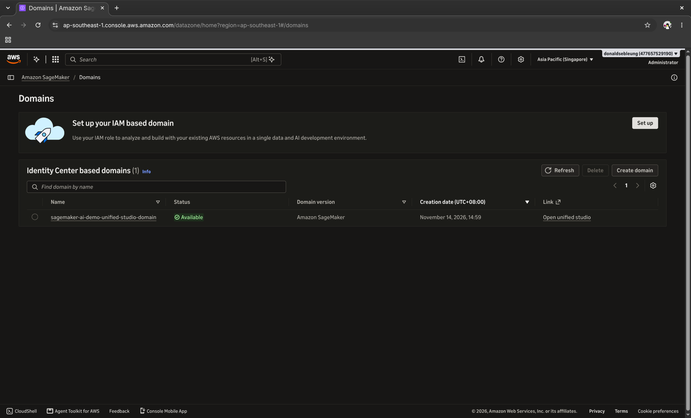
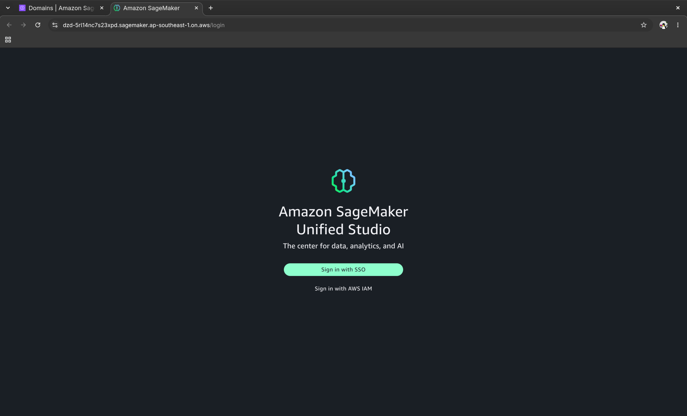
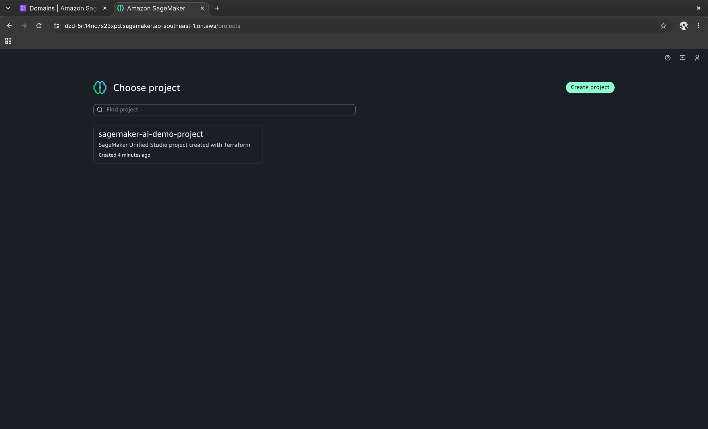
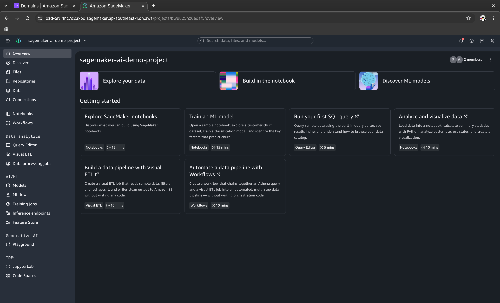
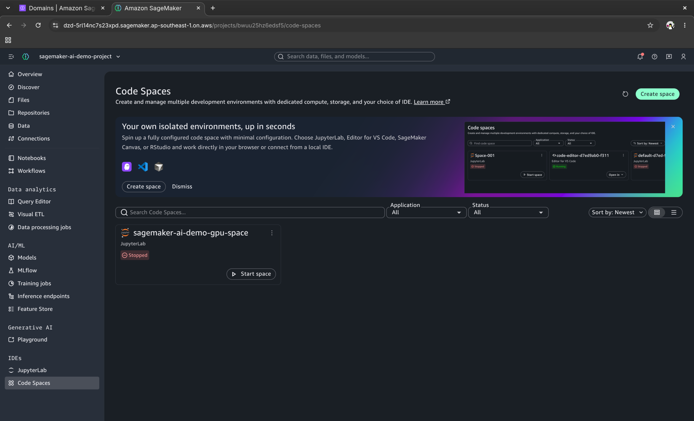
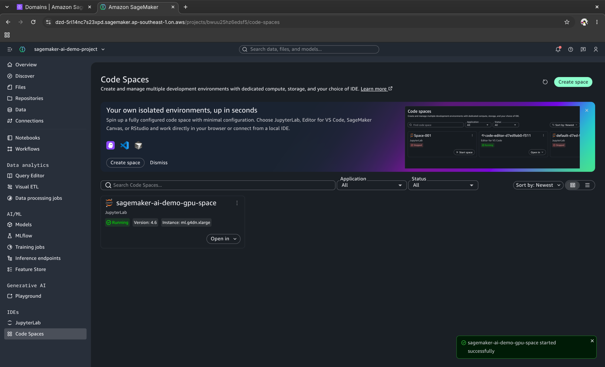
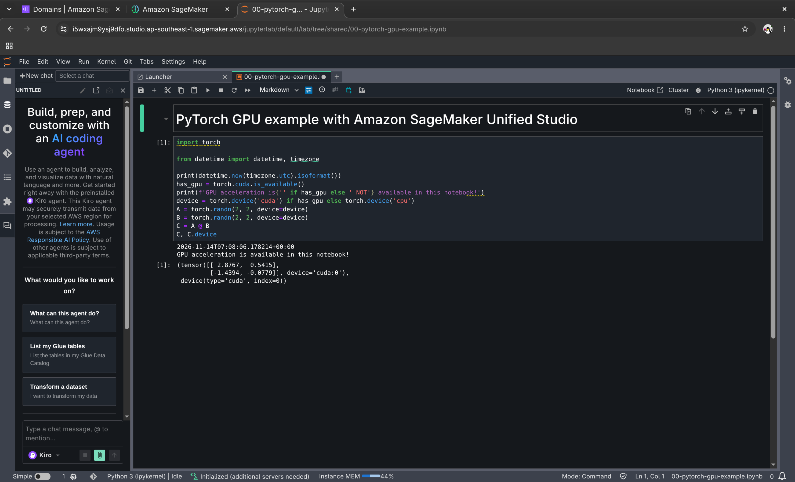

# sagemaker-ai-demo

Amazon [SageMaker AI](https://aws.amazon.com/sagemaker/ai/) Demo

## Overview

This project uses the modules provided in [aws-ia/terraform-aws-sagemaker-unified-studio](https://github.com/aws-ia/terraform-aws-sagemaker-unified-studio) to deploy an end-to-end SageMaker Unified Studio platform with [OpenTofu](https://opentofu.org/).

For those familiar with [Red Hat OpenShift AI \(RHOAI\)](https://www.redhat.com/en/products/ai/openshift-ai), here's a rough analogy between constructs used by both platforms.

| Amazon SageMaker Unified Studio | Red Hat OpenShift AI \(RHOAI\) | Description |
| --- | --- | --- |
| Domain | Platform | The platform installation supporting the organization's AI/ML initiatives |
| Project | Data Science Project | Multi-tenant feature to group AI/ML experiments by subsidiary, application team or business objective |
| Space | Data Science Workbench | Compute environment for running [Jupyter](https://jupyter.org/) notebooks and other AI/ML workloads. Best scoped by user, experiment or set of closely related experiments |

## Quickstart

```bash
tofu -chdir=infra/ init
tofu -chdir=infra/ plan -exclude=module.sagemaker_unified_studio
tofu -chdir=infra/ apply -exclude=module.sagemaker_unified_studio
tofu -chdir=infra/ plan
tofu -chdir=infra/ apply
```

A demo notebook is provided under the `notebook/` directory. Upload it to your SageMaker space, then select "Restart and run all cells" to confirm that GPU acceleration is available in the notebook.

## Caveats

Before deploying this stack, apply for a [service quota](https://docs.aws.amazon.com/general/latest/gr/aws_service_limits.html) increase for "Studio JupyterLab Apps running on ml.g4dn.xlarge instances".

The quota code is `L-39F81BFB` with quota ARN `arn:aws:servicequotas:ap-southeast-1:477657529190:sagemaker/L-39F81BFB`.

## Teardown

Ensure the SageMaker space is stopped, then run:

```bash
tofu -chdir=infra/ destroy
```

## Screenshots















## Responsible GenAI use disclosure

This demo was developed in a pair programming session with [DeepSeek-V4.1-Flash-1017](https://huggingface.co/deepseek-ai/DeepSeek-V4.1-Flash-1017) running on [DeepSeek Harness](https://www.deepseek.com/en/harness/), using the `code-tutor` skill bundled with my [DSH Chat preset](https://github.com/DonaldKellett/dsh-chat-preset) in Standard mode. `DeepSeek-V4.1-Flash-1017` helped provide the code snippets, instructions and detailed explanation with troubleshooting steps which I manually applied to the project.

## License

[Apache 2.0](./LICENSE)
